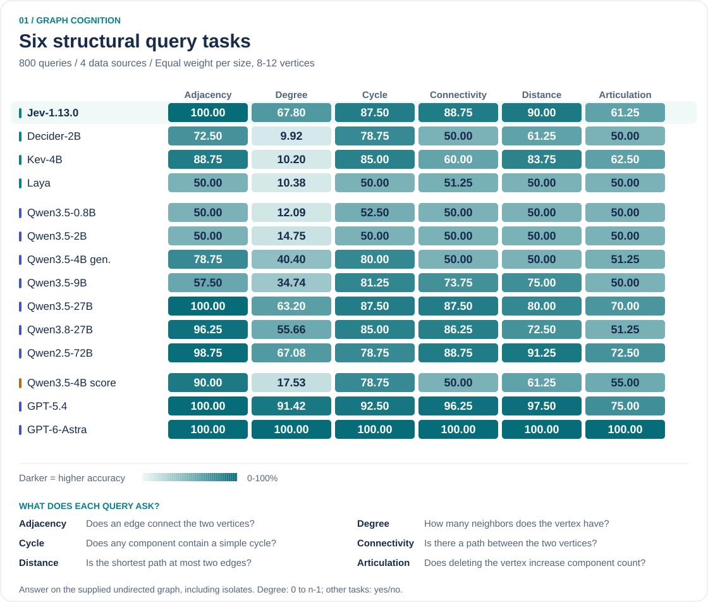
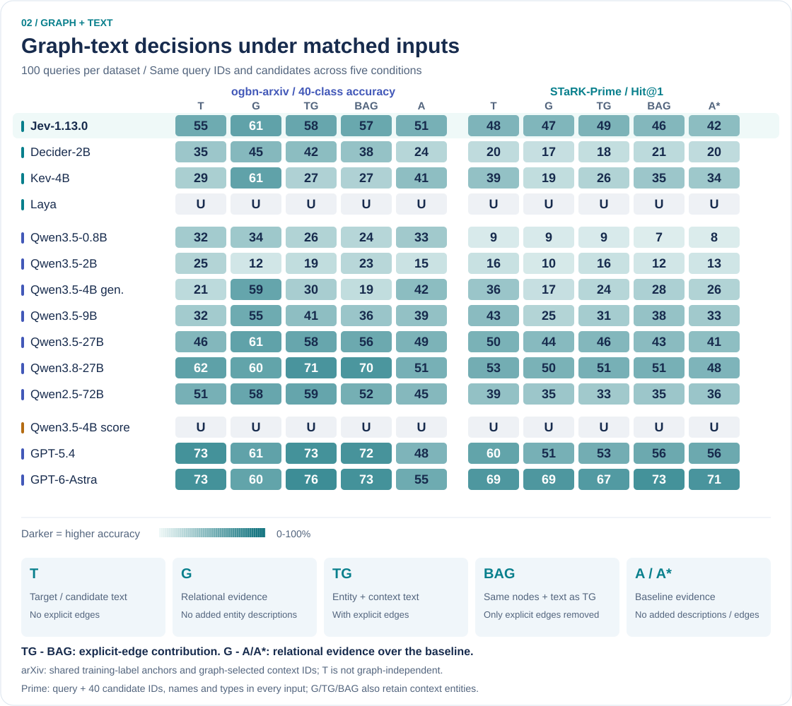
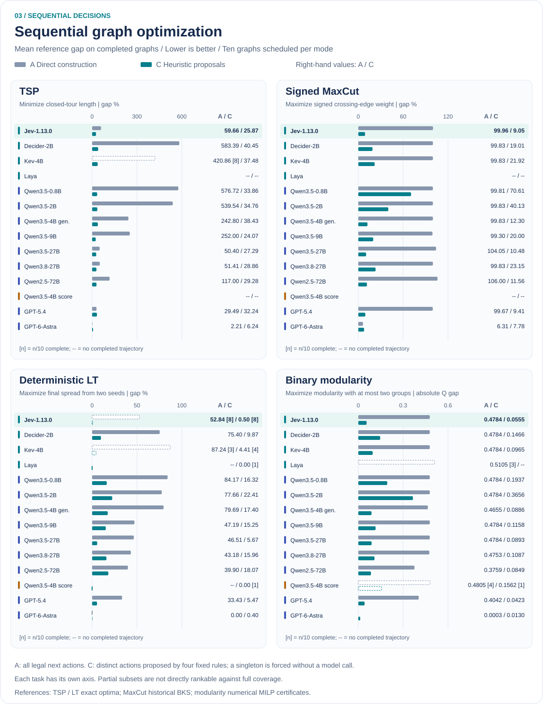

<p align="center">
  
</p>

<p align="center">
  <a href="https://arxiv.org/abs/2610.06354">Paper</a> &nbsp;·&nbsp;
  <a href="#key-findings"><b>Highlights</b></a> &nbsp;·&nbsp;
  <a href="#rq1--graph-cognition">Graph cognition</a> &nbsp;·&nbsp;
  <a href="#rq2--graph-and-text">Graph + text</a> &nbsp;·&nbsp;
  <a href="#rq3--sequential-decisions">Sequential decisions</a> &nbsp;·&nbsp;
  <a href="docs/results.md">Full tables</a> &nbsp;·&nbsp;
  <a href="#configuration">Configuration</a> &nbsp;·&nbsp;
  <a href="#citation">Cite</a>
</p>

**How well do fast decision models understand graphs—and turn choices into good solutions?**
GraphDecisionBench compares Jev, related native selectors and language models through
three complementary tests. The benchmark is model-independent; a common choice
interface does not imply a common architecture or reasoning budget.

**Three research questions:** Can models answer structural queries, use textual
and relational evidence, and build high-quality solutions through successive
choices? The figures report the paper's primary cohorts, not older supporting
experiments. Each task or input condition is evaluated separately; there is no
cross-task overall rank. Interface and inference settings are documented in the
[model configuration](docs/reproduction.md#model-configuration).

The experiments span **fourteen model-interface configurations across RQ1, RQ2
and RQ3**, with unsupported interfaces explicitly marked. The
[summary data](data/results/summary.json) supply all charts and full tables;
per-query and per-trajectory outputs are not distributed in the public bundle.

## Key findings

| Graph cognition | Graph + text | Sequential decisions |
| :--- | :--- | :--- |
| **Local recognition ≠ structural mastery.** | **More evidence ≠ better decisions.** | **Completion ≠ solution quality.** |
| Jev reaches **100% adjacency**, but **67.80% degree** and **61.25% articulation**. | Jev's explicit-edge gain is **+1 pp** on arXiv and **+3 pp** on Prime; both paired intervals include zero. | Proposals reduce Jev's TSP gap from **59.66% to 25.87%**, yet a fixed proposal rule reaches **15.58%**. |

The value of GraphDecisionBench is the **profile**, not a single leaderboard score:
structural correctness, information utility and construction quality answer
different questions.

## RQ1 — Graph cognition

**Six tasks · four real networks · 8–12 vertices · 800 queries per configuration.**

Every query concerns the **supplied simple, undirected graph**, not the full
source network. Isolated vertices remain part of the input.

| Task | What the model must decide | Answer space |
| --- | --- | --- |
| **Adjacency** | Are the two specified vertices joined by an edge? | Yes / no |
| **Exact degree** | How many neighbors does the specified vertex have? | Integers 0 to n−1 |
| **Cycle existence** | Does any component contain a simple cycle through at least three vertices? | Yes / no |
| **Pairwise connectivity** | Is there a path between the two specified vertices? | Yes / no |
| **Distance threshold** | Is their unweighted shortest-path distance at most two? An unreachable pair is a no. | Yes / no |
| **Articulation point** | Does deleting the specified vertex increase the number of connected components? | Yes / no |

Pairwise connectivity does **not** require the whole graph to be connected.
Articulation is defined relative to the original component count, even for an
already disconnected graph.



<p align="center">
  <a href="assets/benchmark/structural-queries.svg">Full-size figure</a> ·
  <a href="docs/results.md#rq1-size-equal-task-accuracy-">Exact values</a>
</p>

- **Jev is strong but uneven.** It matches the large-model baselines on
  adjacency, but the gap on degree and articulation is substantial.
- **Scale weighting matters.** The primary task metric gives each graph size
  equal weight rather than pooling queries.
- **Different predicates test different skills.** Recognizing an edge does not
  establish accurate counting, path reasoning or sensitivity to vertex removal.

<details>
<summary><b>Metric and dataset notes</b></summary>

Sources: Facebook, ca-GrQc, Power Grid and Human PPI, 200 queries each.
There are 400 degree questions and 80 for each other task. Within each
source and size, binary tasks have two yes and two no queries; degree has two
queries for every possible degree. These answer-balanced quotas do not represent
the source networks' natural label frequencies. Independent graph algorithms
compute the reference answers; illegal outputs count as incorrect.

The heatmap uses the primary results; each task is a separate comparison,
not part of a blended score.

</details>

## RQ2 — Graph and text

**Two datasets · five matched inputs · 100 test queries per dataset and condition.**

**ogbn-arxiv** asks for a paper's category among forty classes.
**STaRK-Prime** asks for a biomedical entity matching a query, selected from
forty fixed candidates; any native correct answer is accepted.

### What do T, G, TG, BAG and A/A* contain?

| Input | Additional text in ogbn-arxiv | Additional text in STaRK-Prime | Explicit edges |
| --- | --- | --- | --- |
| **T — Text** | Target paper | Candidate entities | No |
| **G — Relations** | None | None | Directed citation edges / entity relations |
| **TG — Joint input** | Target + context papers | Candidates + context entities | Same relations as G |
| **BAG — Edge-ablated joint input** | Same text and nodes as TG | Same text and nodes as TG | Removed |
| **A / A* — Comparator** | None | None | No |

**What stays fixed?**

- **arXiv:** all five conditions share the target, forty class options,
  training-label anchors and graph-selected context identities. Held-out labels
  are excluded from anchors. **A** is this anchor-based comparator; **T is not
  graph-independent**, because context identities are graph-selected.
- **Prime:** all five retain the query and the same candidate IDs, names and
  types—even when additional entity descriptions are absent. G, TG and BAG
  also retain relation-selected context entities; **A*** retains the candidate
  evidence without those context entities or relations.

**BAG removes only explicit edges from TG.** It is an input ablation, not
“Build-a-Graph” prompting. Omitted information is unavailable to the model,
not a statement that the corresponding edges do not exist.



<p align="center">
  <a href="assets/benchmark/graph-text-decisions.svg">Full-size figure</a> ·
  <a href="docs/results.md#rq2-ogbn-arxiv-accuracy-">arXiv table</a> ·
  <a href="docs/results.md#rq2-stark-prime-hit1-">Prime table</a>
</p>

### Do explicit edges add value?

| Jev paired contrast | ogbn-arxiv | STaRK-Prime |
| --- | ---: | ---: |
| **TG − BAG:** explicit edges, same accompanying text | **+1 pp** [−4, +7] | **+3 pp** [−6, +12] |
| **G − A/A\*:** relations without additional entity text | **+10 pp** [+3, +18] | **+5 pp** [−5, +14] |

Intervals are paired, pointwise 95% bootstrap intervals—not recoverable from
aggregate correct counts. **Relational input helps Jev over arXiv anchors
alone, but adding edges to text-rich input has no clear positive effect.**
High TG accuracy and a positive TG−BAG gain are different claims.
G−A* also adds relation-selected context entities, so it is **not** an edge-only
contrast. Likewise, arXiv TG−T adds context text as well as edges.

<details>
<summary><b>What these comparisons do—and do not—measure</b></summary>

- arXiv has forty classes and shared training-label anchors. Context identities
  are graph-selected even in T, so it is not a graph-independent baseline.
  TG−T adds context text as well as edges.
- Prime is **selection within forty gold-containing candidates**, not
  end-to-end retrieval. A missing native answer is inserted deterministically
  into BM25 top-40; candidates are shuffled without answer markers.
  Candidate Hit@40 is 100% by design; Recall@40 is 77.7241%.
- `U` means unsupported, not zero accuracy. Invalid outputs count as wrong.
- arXiv macro-F1 averages over the fixed forty classes, including zero F1 for
  classes absent from both truth and predictions. It cannot be inferred from
  binary correctness alone.

</details>

## RQ3 — Sequential decisions

**Four optimization tasks · ten graphs each · direct actions versus heuristic proposals.**

| Task | Sequential decision | Objective and instances |
| --- | --- | --- |
| **TSP** | Append an unvisited city to the route | Minimize closed-tour length; TSPLIB EUC_2D, 76–225 cities |
| **Signed MaxCut** | Assign the next vertex to one of two sides | Maximize the signed weight of crossing edges; OPTSICOM, 125 vertices, weights ±1 |
| **Deterministic LT** | Choose two distinct seeds before diffusion | Maximize final active nodes; directed email-Eu-core subgraphs, 50–150 vertices |
| **Binary modularity** | Assign the next vertex to one of at most two communities | Maximize resolution-1 modularity; ca-GrQc subgraphs, 50–150 vertices |

The evaluator updates the partial solution after each choice. Later states
therefore depend on the model's own earlier decisions, rather than following
a shared precomputed trajectory.

**A — Direct construction:** choose among all legal next actions.

**C — Heuristic-proposal selection:** choose among distinct next actions
proposed by four named fixed rules. Duplicate proposals are merged; a singleton
is forced without a model call. These A/C mode names are local to RQ3 and are
unrelated to RQ2's A/A* input comparator.



<p align="center">
  <a href="assets/benchmark/optimization-trajectories.svg">Full-size figure</a> ·
  <a href="docs/results.md#rq3-tsp--gap">Exact gaps and coverage</a>
</p>

### Proposals help—but how much is the model contributing?

| Jev task | Direct gap | Proposal gap | Fixed-rule comparison | Complete A / C |
| --- | ---: | ---: | --- | --- |
| TSP | 59.66% | **25.87%** | `return_reserve`: **15.58%** | 10/10 · 10/10 |
| Signed MaxCut | 99.96% | **9.05%** | `greedy_completion`: **8.87%** | 10/10 · 10/10 |
| Deterministic LT | 52.84% | **0.50%** | Partial cohort—compare on matched graphs | **8/10 · 8/10** |
| Binary modularity | 0.4784 Q | **0.0555 Q** | `greedy_completion`: **0.0361 Q** | 10/10 · 10/10 |

Lower is better. Strong improvement over direct construction does **not**
establish improvement over the proposal rules themselves. Fixed-rule and
matched random-selection controls distinguish the quality of the proposal
set from the model's contribution in choosing among its actions.

<details>
<summary><b>Coverage, references and fair comparisons</b></summary>

- Across fourteen configurations, **951/1,120 trajectories complete**,
  165 are unsupported and four fail. Jev completes 76/80; its four failures are
  context-capacity HTTP errors on the two 150-node LT graphs, in both modes.
- Means use completed trajectories. Compare modes and controls on the same
  completed-instance subset; a partial result is not rankable against a
  full-ten-graph result. Forced-only completion does not establish interface support.
- TSP uses published optima, LT exhaustive two-seed optima, signed MaxCut
  historical 2016 BKS, and binary modularity numerical MILP-certified optima.
  TSP/LT/MaxCut gaps are $|f_i-R_i|/R_i\times100$ with positive references,
  reported in percent; modularity uses $Q_i^*-Q_i$ in **absolute Q units**.
  No completed primary solution in the three percentage-gap tasks improves on its reference.
- Modularity residuals retain their sign. Non-GPT modularity objectives were rounded to
  four decimals before rebasing; additional printed digits are not extra precision.
- LT activates both seeds simultaneously, using synchronous irreversible
  diffusion, incoming-edge weights 1/indegree and threshold 1/2. It is not
  the random-threshold LT model. Binary modularity permits a single community.

</details>

## Results, data and scope

| Resource | What it contains |
| --- | --- |
| [Complete result tables](docs/results.md) | All fourteen configurations, taskwise scores, gaps and completion counts |
| [Figure source data](data/results/summary.json) | Manuscript-transcribed aggregates for fourteen configurations; all charts and full tables share this source |
| [Result scope and provenance](data/results/README.md) | Aggregate schema, metrics and interpretation limits across all fourteen configurations |
| [Dataset documentation](data/README.md) | Source downloads, normalization and the optimization catalog |
| [Workflow configurations](configs/README.md) | YAML coverage, action parameters, previews, permissions and artifact prerequisites for every public task workflow |
| [Reproduction and model settings](docs/reproduction.md) | Offline reporting, configuration, tests and fresh-clone limitations |

Historical and supplementary experiments are **independent cohorts**, with
different sampling, candidate pools or reference values. Their assets are not
distributed in the current compact bundle and have not been pooled into the
primary results. Charts and tables render from the aggregate summary, not raw
response replay; aggregate values do not reconstruct individual model outputs.

**Readouts differ.** Native selection, constrained generation and candidate-token
scoring retain their own support limits. Inference budgets are not matched;
the [model configuration table](docs/reproduction.md#model-configuration)
records reasoning and decoding settings. These comparisons do not establish
a matched-hardware speed ranking.

## Configuration

All public task and result workflows use [run_benchmark.py](run_benchmark.py)
with YAML configurations. See the [configuration guide](configs/README.md) for
synthetic development, six-task real-network evaluation, graph-text,
optimization, supplied-input proposals and aggregate reporting.

```bash
# Configuration-only preview: no runner, artifact checks, downloads or inference.
python run_benchmark.py --config configs/development.yaml --check
# Actual offline consistency check of the distributed aggregate presentation.
python run_benchmark.py --config configs/results.yaml
```

All configs use `schema_version: 1`. Workflow configs select one explicitly
configured action; they never chain actions. The three topology-format
adjacency/distance smoke configs remain compatible, not
primary-cohort reproductions. Every `run` requires `--allow-inference`;
download-capable actions require `--allow-downloads`, even if cached. Existing
approval and integrity gates still apply. A successful preview does not mean
the required artifacts exist or that a primary experiment can be reproduced.

### Optional live interface smoke

After separately starting a local vLLM server, an optional bounded check is:

```bash
python -m src.utils.live_smoke --provider vllm --model YOUR_SERVED_MODEL --base-url http://127.0.0.1:8000/v1 --output output/runtime/live-smoke-local --allow-inference
```

Alternatively use `--provider github_copilot --model gpt-5.4` without `--base-url`,
with authentication configured separately. Use a fresh output directory each time.
This checks **12 synthetic task types**: adjacency, degree, cycle, pair connectivity,
distance threshold, articulation, arXiv-style classification, Prime-style 40-choice
selection, TSP, MaxCut, deterministic LT and binary modularity. It uses one instance
per type, direct arm A for construction and TG for graph-text (not an A/C comparison).
These fixtures are **not primary reproduction**, and there is **no accuracy guarantee**.
The runner downloads nothing, starts no model, makes no calls without opt-in, uses
45-second call limits and an approximately 600-second total budget, and never retries.
Slow constructions may remain incomplete so later task types can be attempted.
Copilot SDK-internal retries cannot be disabled by this adapter; observed retries
are rejected and reported, not silently treated as one call.
The summary separates observed transport attempts, protocol completion and semantic
results; every type must have a call observed, not just forced steps. Counts are
outbound HTTP attempts or observed SDK turns, not proof of server-side forward counts.
Traces contain normalized responses and sanitized transport metadata, not provider
error bodies. Exit codes: 0 for complete interface coverage (not accuracy), 1 for
incomplete/failed coverage, 2 for CLI/setup refusal. No live outcome is asserted here.

## Citation

If you use the benchmark, code or results, please cite the
[GraphDecisionBench paper](https://arxiv.org/abs/2610.06354). For code-based
experiments, also identify the package version or commit used:

```bibtex
@misc{graphdecisionbench2026,
  title        = {GraphDecisionBench: Benchmarking System One Models on Graph Tasks},
  author       = {Yang, Xianliang and Zhang, Yapu and Zhao, Li},
  year         = {2026},
  eprint       = {2610.06354},
  archivePrefix = {arXiv},
  primaryClass = {cs.AI},
  doi          = {10.48550/arXiv.2610.06354},
  url          = {https://arxiv.org/abs/2610.06354}
}
```

[Machine-readable citation](CITATION.cff). The unversioned arXiv link points to
the latest available paper revision. Code is maintained in the
[GraphDecisionBench repository](https://github.com/VictorYXL/GraphDecisionBench).
If reusing data,
also cite the original sources: [SNAP](https://snap.stanford.edu/data/),
[Power Grid](https://websites.umich.edu/~mejn/netdata/),
[BioSNAP](https://snap.stanford.edu/biodata/),
[OGB](https://ogb.stanford.edu/docs/nodeprop/#ogbn-arxiv),
[STaRK](https://stark.stanford.edu/),
[TSPLIB](http://comopt.ifi.uni-heidelberg.de/software/TSPLIB95/) and
[OPTSICOM](https://grafo.etsii.urjc.es/optsicom/maxcut.html).
Source-specific provenance and citation requirements are described in the
[data documentation](data/README.md).
